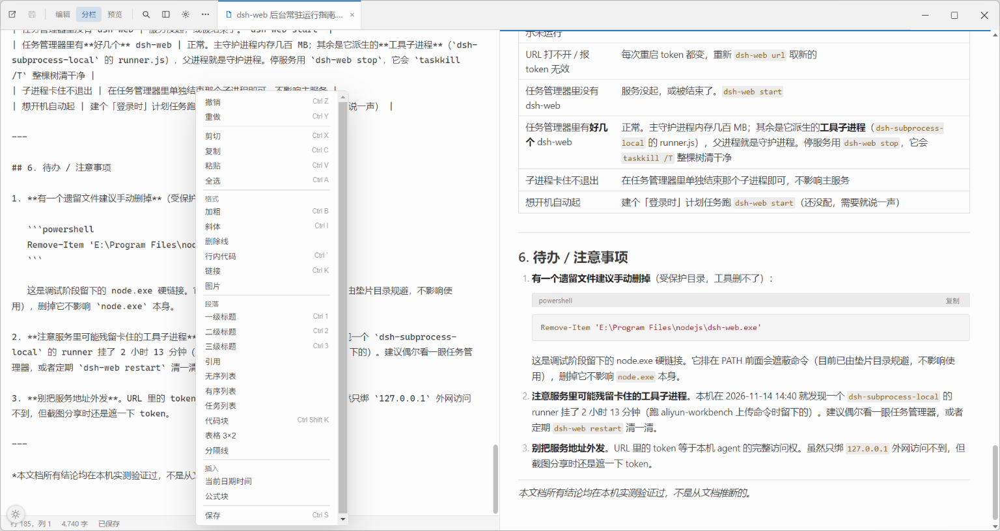

# 编辑能力与界面调整（v1.3.0）

> 日期：2026-11-14　　基线：1.2.1 → 1.3.0
> 本次解决三件事：**为什么装了 1.2.1 还是不能编辑**、**功能按钮迁到左上角**、**编辑区右键菜单**。

---

## 0. 一句话结论

1.2.1 不能编辑**不是安装或打包坏了**，而是这个版本里根本没有写盘能力——它是只读查看器。这次把「源码编辑 + 实时预览」补上，同时按你的要求把按钮移到左上角，并给编辑区加了完整的右键菜单。



---

## 1. 排查思路（为什么 1.2.1 仍然不能编辑）

按"先排除低级原因、再确认功能是否存在"的顺序查了四层：

| 层 | 检查内容 | 结果 |
|---|---|---|
| 1. 版本 | 装的是不是 1.3.0 / 代码有没有更新 | 1.2.1 的 `dist` 包与源码一致，运行的是新版本 |
| 2. 入口 | 界面上有没有"编辑"入口 | 顶栏只有打开/查找/侧栏/设置/更多，**没有编辑入口** |
| 3. 结构 | 正文节点能不能输入 | `<article id="view">`（`index.html:95`），只接收渲染后的 HTML |
| 4. 能力 | 有没有写文件的通道 | 全仓库 `contenteditable` **0 处**；IPC 只有导出 PDF；`Ctrl+S` 会主动弹"这是只读查看器" |

**结论**：不是功能失效，是该功能从未实现。所以本次不是"修 bug"，而是补一块新能力，并把"只读"这个默认行为保留下来——打开文档仍然不写盘，只有你主动切到编辑并保存才动文件。

---

## 2. 改动范围（文件级）

### 2.1 新增

| 文件 | 作用 | 关键位置 |
|---|---|---|
| `src/md-edit.js` | 编辑变换纯函数（加粗、斜体、标题、列表、引用、代码块、表格、缩进…），返回"替换区间 + 新选区"，可被 Node 直接单测 | `wrapInline` / `heading` / `toggleLinePrefix` / `insertBlock` / `table` / `lineInfo` |
| `src/renderer/js/editor.js` | 编辑区：三态切换、实时预览、脏标记、保存与冲突处理、列表续写、Tab 缩进、状态栏、滚动联动 | `applyMode` / `onActivate` / `save` / `confirmClose` / `continueList` / `replaceRange` |
| `src/renderer/js/ctx-menu.js` | 编辑区右键菜单（4 个分组 + 22 个操作） | `SECTIONS` / `open` / `close` |

### 2.2 修改

| 文件 | 改动 |
|---|---|
| `src/renderer/index.html` | 工具栏从标签栏右侧移到左侧；新增保存按钮、编辑/分栏/预览切换；新增 `#editor-pane` 与状态栏 |
| `src/renderer/style.css` | 新增编辑区、模式切换、右键菜单、确认框样式；`#titlebar` 改为左对齐；打印时隐藏编辑区 |
| `src/renderer/js/tabs.js` | 标签增加 `dirty` 标记与圆点；关闭前二次确认；外部修改时不覆盖未保存内容；导出 `renderText` |
| `src/renderer/js/main.js` | `Ctrl+S` 改为保存、`Ctrl+E` 切换视图；新增菜单命令 `save` / `mode-*` |
| `src/renderer/js/util.js` | 新增 `MDV.confirm`（页内确认框，可测试）与 `state.mode` |
| `src/preload.js` | 暴露 `saveFile`、`readText`，以及 `MDVEdit` 编辑模块 |
| `src/ipc.js` | 新增 `mdv:save-file`：原子写 + 冲突检测 + 保留 BOM/换行 |
| `src/main.js`（主进程） | 新增「编辑」菜单；「文件」加保存；「视图」加三种模式；`Ctrl+B` 改为交给渲染进程判断焦点 |
| `package.json` | 版本 1.2.1 → **1.3.0** |
| `tools/smoke.js` | 新增 22 项编辑变换单测（共 59 项） |
| `tools/e2e.js` | 新增 12 项编辑交互（共 66 项）；mermaid 断言改轮询，消除慢机器误报 |
| `tools/packaged-check.js` | 打包自检新增 4 项编辑相关断言（共 14 项） |

---

## 3. 界面调整：功能按钮迁到左上角

### 3.1 结构

调整前：`[标签栏][打开][查找][侧栏][设置][更多]`
调整后：`[打开][保存] | [编辑][分栏][预览] | [查找][侧栏][设置][更多] [标签栏]`

DOM 上把 `.tb-actions` 移到 `#tabs` 之前，CSS 里去掉 `margin-left: auto`，标签栏改由 `flex: 1` 吃掉剩余宽度，并加一条分隔线。

### 3.2 与 Windows 原生按钮的避让

按钮左移后，右侧仍然要给最小化/最大化/关闭留位置。这条规则沿用 1.2.1 的修复，不再写死像素：

```css
#titlebar {
  padding-right: max(144px, calc(100vw - env(titlebar-area-x, 0px) - env(titlebar-area-width, 100vw) + 8px));
}
```

在 1536 / 1280 两种窗口宽度下实测，工具栏最右侧按钮距原生按钮区仍有 9px 余量。

---

## 4. 编辑能力

### 4.1 三种视图

| 模式 | 表现 | 入口 |
|---|---|---|
| 编辑 | 只显示编辑区，全宽 | 顶栏「编辑」、`Ctrl+E`、视图菜单 |
| 分栏 | 左编辑、右预览，滚动比例联动 | 顶栏「分栏」、`Ctrl+E`、视图菜单 |
| 预览 | 只显示渲染结果（默认） | 顶栏「预览」、`Ctrl+E`、视图菜单 |

模式会记住，下次启动沿用；但**没有打开文档时始终显示欢迎页**，不会出现"上次是编辑模式、这次只剩空白"的情况。

### 4.2 右键菜单

| 分组 | 条目 |
|---|---|
| 编辑 | 撤销、重做、剪切、复制、粘贴、全选 |
| 格式 | 加粗、斜体、删除线、行内代码、链接、图片 |
| 段落 | 一级/二级/三级标题、引用、无序列表、有序列表、任务列表、代码块、表格 3×2、分隔线 |
| 插入 | 当前日期时间、公式块 |
| 底部 | 保存 |

菜单会自动避开窗口边缘；点击外部、按 Esc、切换窗口时自动关闭。刚弹出后的 250ms 内忽略滚动事件，避免编辑器把光标滚入视野时把菜单顶掉。

### 4.3 快捷键

| 操作 | 快捷键 |
|---|---|
| 保存 | `Ctrl+S` |
| 编辑 / 分栏 / 预览 | `Ctrl+E` |
| 加粗 / 斜体 / 链接 | `Ctrl+B` / `Ctrl+I` / `Ctrl+K` |
| 行内代码 | `` Ctrl+` `` |
| 缩进 / 反缩进 | `Tab` / `Shift+Tab` |
| 列表续写 | 回车自动延续；空列表项再回车退出 |
| 撤销 / 重做 | `Ctrl+Z` / `Ctrl+Y`（原生撤销栈） |

> 注意：`Ctrl+B` 在编辑区是「加粗」，在预览区才是「打开文件列表」。菜单加速键改为 `registerAccelerator: false`，由渲染进程按焦点判断，避免两个功能抢同一个键。

---

## 5. 保存的安全性

只读变可写，风险全在"写"这一步。这次做了五道保护：

| 措施 | 解决的问题 |
|---|---|
| **原子写**：先写 `xxx.mdv-save-*` 临时文件，再 `rename` 覆盖 | 写到一半断电/崩溃，不会留下半截文件 |
| **冲突检测**：保存时带上打开时记录的 `mtime`，磁盘 mtime 变了就拦下 | 别的程序改过同一文件时，不会静默覆盖 |
| **保留 BOM / 换行风格** | 避免 git 上出现"整篇都改了"的假差异 |
| **外部修改不覆盖**：有未保存内容时，`fs.watch` 只提示"重新加载会丢弃修改" | 编辑到一半被别的程序改盘，不会丢字 |
| **未保存确认**：关闭脏标签时弹「保存并关闭 / 不保存 / 取消」 | 误关标签丢内容 |
| **关窗保护**：直接关窗口时，若有未保存文档，弹「保存并退出 / 不保存退出 / 取消」 | 误关整个程序丢内容 |

另外，文件在编辑期间被删除时不允许保存（会提示先另存），避免凭空重建一个文件。

---

## 6. 验证

| 项目 | 结果 |
|---|---|
| `npm run lint` | 27 个文件语法通过 |
| `npm test`（渲染 + 编辑变换） | **59 项通过** |
| `npm run e2e`（真实交互） | **66 项通过**，含：分栏可见、输入即脏、实时预览、`Ctrl+B`、右键菜单 22 项、斜体命令、`Tab` 缩进、保存落盘、关闭确认 |
| `npm run verify:dist` | 打包产物 **14 项通过**（新增编辑区/三档按钮/保存按钮/MDVEdit 注入） |
| 真机截屏 | 按钮左置完整、右键菜单无裁切、分栏滚动联动正常 |

---

## 7. 已知限制与后续可选项

| 限制 | 说明 |
|---|---|
| 不是所见即所得 | 编辑区写 Markdown 源码，右侧预览。WYSIWYG 需要反向序列化，表格/公式极易失真，暂不做 |
| 无自动保存 | 由 `Ctrl+S` 或按钮触发；关闭脏标签有确认，不会丢 |
| 无语法着色 / 多光标 / 代码折叠 | 编辑器是原生 `textarea`，零依赖、稳定；重度编辑建议外接 VS Code |
| 无"另存为" | 当前只保存到原文件；需要复制一份请用资源管理器 |

如果后续要把编辑体验再往上提一档，最划算的一步是把 `textarea` 换成 CodeMirror 6：有 Markdown 语法着色、行内快捷键、多光标，代价是新增约 400KB 前端产物与一层构建配置。
